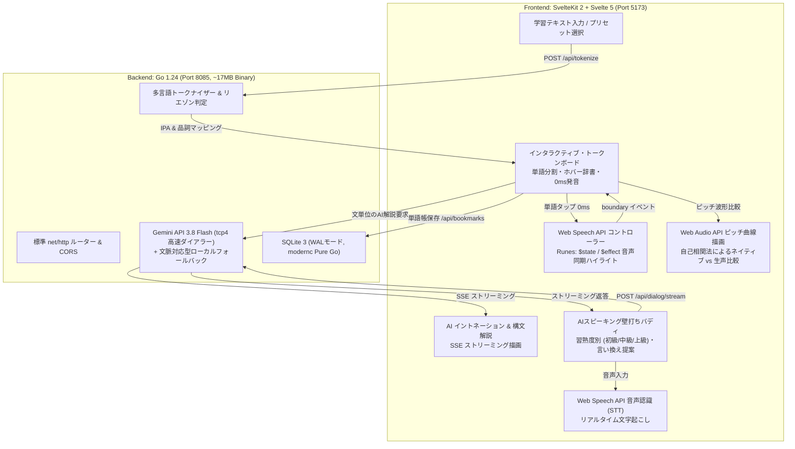

# LinguaLight — 多言語インタラクティブ学習 & 音声発音ワークベンチ

[-FF3E00.svg)](https://svelte.dev)
[](https://kit.svelte.dev)
[](https://golang.org)
[-003B57.svg)](https://sqlite.org)
[](https://ai.google.dev)
[-4CAF50.svg)](https://developer.mozilla.org/en-US/docs/Web/API/Web_Speech_API)
[-9C27B0.svg)](https://developer.mozilla.org/en-US/docs/Web/API/Web_Audio_API)
[](https://docker.com)

---

## 🎯 プロダクトの目的と設計思想

### 【目的】AIの力で、語学学習のユーザー体験（UX）を圧倒的に向上させる
本プロダクトのすべての機能・設計判断は、**「学習者が待ち時間や操作のストレスを一切感じず、自然に・楽しく・確実に発話力を鍛えられる最高のUXを提供すること」** を唯一無二の目的としています。

### 【手段】"Write, Right, Light" のエンジニアリング規律
目的である「AIによるUX向上」を持続的・安定的に実現するための開発アプローチです。単なる技術の自己満足を排し、プロフェッショナルな品質担保とパフォーマンスの両立を図っています。



#### 1. Right（データ整合性と高可用性）
- **多言語ドメインの構造化**:
  言語コード（ISO 639-1）、国際音声記号（IPA）、品詞（POS）、音の繋がり（Liaison）を厳格にモデル化し、自然言語データを型安全にバックエンドで検証・マッピング。
- **2重のフォールバック・可用性設計**:
  外部LLM APIへの過度な依存を避け、Gemini APIキー未設定・レート制限・ネットワーク切断時でも、Go内部の**文脈理解型フォールバックエンジン**が即座に代替ストリーミングを実行。音声再生もブラウザ標準の **Web Speech API** を採用することで、完全オフライン環境でも発音確認を継続できる冗長性を確保。
- **IPv4 専用（`tcp4`）ダイアラー**:
  Windows 環境等での IPv6 デュアルスタック名前解決による 60〜75 秒の潜在的ハングを根絶。接続待機を **0.3 秒台** に短縮し、ミリ秒単位の即応性を担保。

#### 2. Light（超低遅延・入力負荷ゼロのUX）
- **Svelte 5 Runes（ゼロ仮想DOM）**:
  仮想DOMのdiff検出オーバーヘッドを排除し、シグナルベースのリアクティビティ（`$state`, `$derived`, `$effect`）を採用。長文テキストであっても、単語ホバー時の辞書表示や音声再生に合わせたミリ秒精度のカラオケ風ハイライトを 60fps（遅延 0ms）で追従。
- **純粋な Web Audio API によるピッチ検出**:
  外部ライブラリを一切使わず、ブラウザ標準の `AudioContext` と自己相関法（Autocorrelation）により、リアルタイムに声の基本周波数（$F_0$: 80Hz〜380Hz）を計測し、HTML5 Canvas に滑らかに描画。
- **Go 1.24 による軽量シングルバイナリ**:
  CGO非依存の Pure Go SQLite (`modernc.org/sqlite`) を採用し、実行バイナリわずか **17MB**・起動メモリ **20MB台** を実現。コールドスタートなしで即座にAPI・SSEリクエストを処理。

#### 3. Write（型安全性・自動テスト・保守性）
- **エンドツーエンドのスキーマ統一**:
  Goの構造体定義とSvelteKitのTypeScript型定義を厳格に一致させ、フロント/バック間の境界でのランタイムエラーを防止。
- **自動テスト網と静的検査**:
  Go標準のテストフレームワークによるトークン分割・音節リエゾン検出・Admin CRUD認可・DB整合性の単体テスト（`go test` PASS）および、TypeScript/Svelte 5 の厳格な静的型検査（`svelte-check` エラー・警告ゼロ）を徹底。

---

## 🚀 主要機能 (Features)

| 機能 | 詳細 |
| :--- | :--- |
| **0ms インタラクティブ発音** | 単語をクリックした瞬間に Web Speech API でネイティブ発音を再生。 |
| **IPA国際音声記号 & 辞書ポップアップ** | 単語ホバー時に、IPA発音記号・品詞・日本語訳・リエゾンヒントを瞬時にプレビュー。 |
| **リアルタイム・カラオケ同期ハイライト** | 音声読み上げイベント（`boundary`）を検知し、発声中の単語をミリ秒精度でハイライト追従。 |
| **📈 イントネーション波形比較 (Pitch Contour)** | 各文で **Web Audio API** を用いたリアルタイムピッチ抽出を実施。青色破線（ネイティブお手本の強勢・疑問文上昇カーブ）とオレンジ実線（ユーザーの生声）を重ねてプロットし、100点満点の一致スコアと改善アドバイスを表示。 |
| **🎙️ リアルタイム音声認識 (Speech-to-Text)** | 壁打ちモーダルにて、マイクから話しかけた英語や他言語を瞬時にリアルタイム文字起こしして入力欄へ自動転記。 |
| **AI イントネーション & 構文解析 (SSE)** | Gemini 3.8 Flash により、「イントネーションの山」「音の脱落（リダクション）」「構文の骨組み」をリアルタイムにタイプライター風ストリーミング表示。 |
| **習熟度別 AI壁打ち対話 (Speaking Sparring)** | 初級（Beginner）・中級（Intermediate）・上級（Advanced）の3段階レベルに応じた語彙・スピード調整。返答の自動音声読み上げ・自然な日本語訳・ネイティブ言い換え（Better Phrasing）・発音のコツを提示。 |
| **多言語切り替え** | 英語（US/UK）、スペイン語、フランス語、ドイツ語、イタリア語、日本語などをシームレスに切り替え。 |
| **ワンタップ学習プリセット** | 日常会話、IT技術ディスカッション、カフェ・レストラン注文、音声学・リエゾン特訓などのサンプル文を即座に読み込み。 |
| **管理者権限 & 例文CRUD管理** | `X-Admin-Secret` による認可制御。管理者は画面上から新しい学習例文を即座に追加・削除し、SQLiteへ永続化可能。 |
| **マイスペース（単語帳・フレーズ保存）** | 気になった単語や文をワンクリックでSQLiteに保存・復習可能。 |

---

## 🛠️ 技術スタック (Tech Stack)

### Frontend
- **Framework**: SvelteKit 2 (`@sveltejs/kit` ^2.63.0)
- **UI Library**: Svelte 5 (`svelte` ^5.56.1, Runes: `$state`, `$derived`, `$effect`)
- **Language**: TypeScript (`^6.0.3`)
- **Styling**: Tailwind CSS v3 (`^3.4.17`), PostCSS, Autoprefixer
- **Icons**: Lucide Svelte (`^0.475.0`)
- **Speech (TTS & STT)**: Web Speech API (`SpeechSynthesisUtterance`, `SpeechRecognition`)
- **Audio & Visualization**: Web Audio API (`AudioContext`, `AnalyserNode`, HTML5 Canvas)

### Backend
- **Language**: Go 1.24 (Windows / Linux)
- **Server**: Go 標準 `net/http` (SSE `text/event-stream` サポート, `tcp4` IPv4高速ダイアラー)
- **Database**: SQLite 3 (WALモード, `modernc.org/sqlite` Pure Go)
- **AI/LLM**: Google Gemini API (`gemini-3.8-flash` + 文脈適応型フォールバックエンジン)

### DevOps & Infrastructure
- **Container**: Docker / Docker Compose (Multi-stage Alpine builds)

---

## 🏃 起動方法 (Getting Started)

### 方法 1: Docker Compose で一括起動（推奨）

```sh
# リポジトリのクローン
git clone https://github.com/mizoe0829/lingua-app.git
cd lingua-app

# （任意）Gemini APIキーを設定する場合は環境変数を渡す
export GEMINI_API_KEY="your-api-key-here"

# コンテナのビルドと起動
docker compose up --build
```
- フロントエンド: `http://localhost:5173`
- バックエンド API: `http://localhost:8085`

---

### 方法 2: ローカル環境で起動

#### 1. バックエンド (Go)
```sh
cd backend
go run cmd/server/main.go
# 起動確認: http://localhost:8085/health
```

#### 2. フロントエンド (SvelteKit)
```sh
cd frontend
npm install
npm run dev
# アクセス: http://localhost:5173
```

---

## 🧪 テストの実行 (Testing)

### Go バックエンド単体テスト
```sh
cd backend
go test -v ./...
```

### フロントエンド型検査 (TypeScript & Svelte 5)
```sh
cd frontend
npm run check
```

